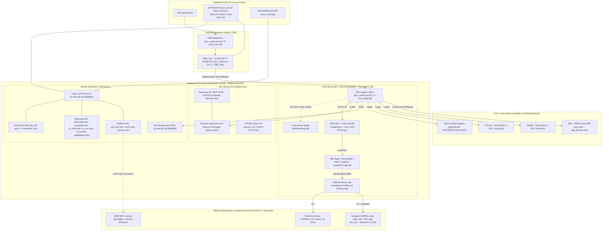
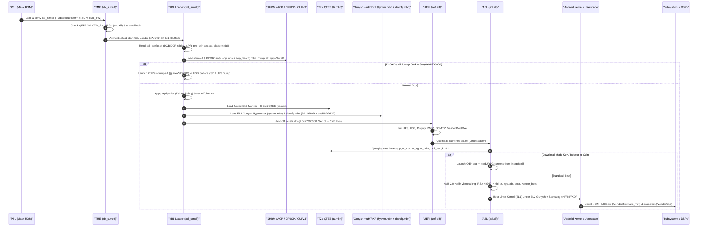
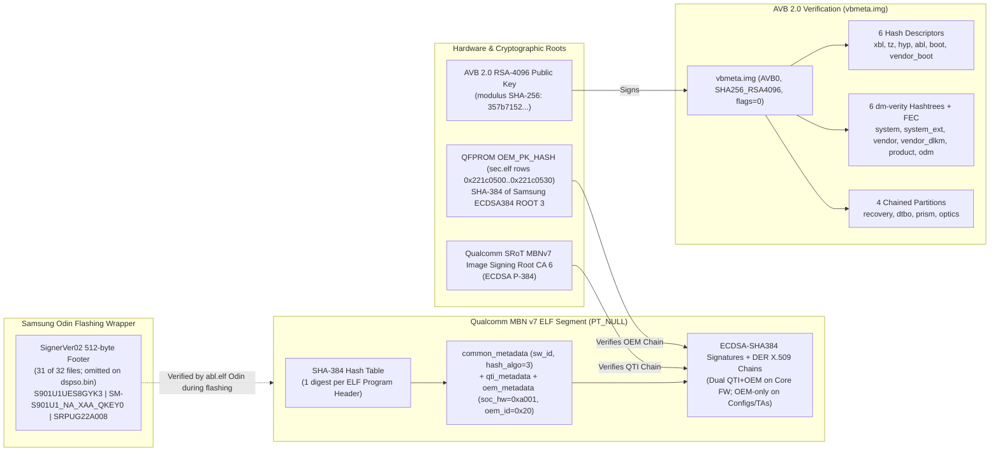
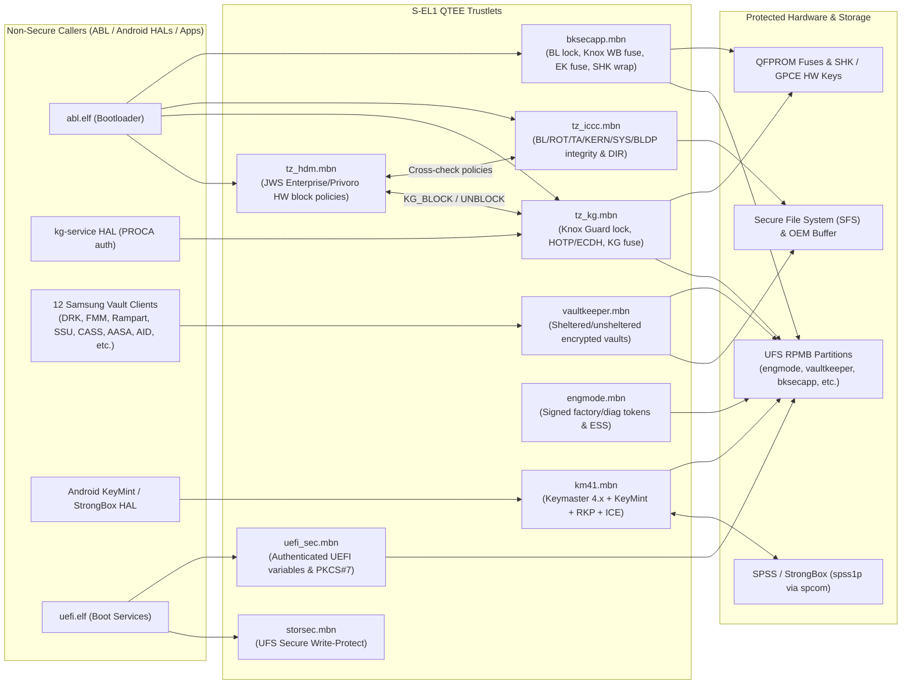

# Samsung Galaxy S22 (`SM-S901U1`) Bootloader & Firmware Architecture

This document describes the architecture, binary structure, trust boundaries, and boot/runtime interactions of the **32 firmware images** in the extracted Samsung **`BL` (Bootloader)** package.

---

## 1. Platform & Build Identity

| Property | Observed Value |
| :--- | :--- |
| **Device / Model** | Samsung Galaxy S22 (`r0q`, `SM-S901U1`, CSC `NA_XAA`, `R0Q_USA_OPEN`) |
| **Samsung Build / CL** | `S901U1UES8GYK3` / CL `103321188R` (signed `2025-11-10`) |
| **SoC / Platform** | Qualcomm Snapdragon 8 Gen 1 (`SM8450` / `SM8450P`, codename `Waipio`, `soc_hw=0xa001`, `oem_id=0x20`) |
| **Qualcomm Metabuild** | `Waipio.LA.1.0.r1-00808-STD.PROD-1` |
| **Core Firmware Versions** | Boot `BOOT.MXF.2.0-00805-WAIPIO-1` · TZ/Hyp `TZ.XF.5.18-44858-40` (`WAPIONAAA`) · AOP `AOP.HO.4.0-00388-WAIPIO_E-1` · CPUCP `CPUCP.FW.1.0-00081-WAIPIO.EXT-5` · DDR `272.56.227` |
| **AVB Security Patch** | `2025-11-01` (Boot/Vendor OS `12`, System OS `16` per `vbmeta.img` properties) |

---

## 2. SoC Hardware & Execution Privilege Architecture

The Snapdragon 8 Gen 1 (`SM8450`) runs firmware across **six distinct processor architectures / execution environments**: the Trust Management Engine (TME), Application Processor Subsystem (`APSS` ARMv8 across EL3/S-EL1/EL2/EL1/EL0), three power/memory/serial microcontrollers (`AOP`, `CPUCP`, `SHRM`, plus `QUPv3` serial engines), Hexagon `QDSP6` DSPs (`ADSP`, `CDSP`, `SLPI`, `GPU ZAP`, `IPA`), Tensilica `Xtensa` media processors (`CAMERA_ICP`, `VPU`, `EVA`), and the Secure Processing Subsystem (`SPU`).

---

## 3. Boot Sequence & Execution Flow

### Cold Boot, Verified Boot, Download Mode & Crash Dump Paths

---

## 4. Cryptographic Signing, Verification & Container Layers

Every binary in this package sits inside a multi-layered trust envelope tying hardware fuses (`QFPROM`) to Qualcomm MBN v7, Android Verified Boot (`AVB 2.0`), and Samsung's Odin flashing signature (`SignerVer02`).

### Key Container Observations
1. **MBN v7 Metadata vs. Legacy OU Fields**: Unlike older Qualcomm MBN v3/v5 images, MBN v7 stores `sw_id`, `hw_id`/`soc_hw`, `oem_id`, and `anti_rollback_ver` in binary metadata structs (`common_metadata` / `qti_metadata` / `oem_metadata`) rather than X.509 `OU` strings.
2. **Qualcomm Wrapper Machine-ID Quirks**:
   - `xbl_s.melf` (sub-ELF 0) and `xbl_config.elf` set `e_machine = EM_M32` (`AT&T WE32100`, value `1`) as Qualcomm's dummy tag for proprietary data/sequencer containers.
   - `uefi.elf` (`ELFCLASS64`) and `abl.elf` (`ELFCLASS32`) set `e_machine = EM_ARM` (`40`) on the outer ELF wrapper even though every PE32+/TE UEFI driver and application inside their Firmware Volumes is **AArch64 (`0xaa64`)**.
3. **Production Blank Placeholders**: `QcomCate.fv`, `quest.fv`, and `testvector.fv` are 100% zero-filled (`0x00`) up to their 512-byte `SignerVer02` footer; meanwhile, `Core_NON-HLOS.bin` holds the actual LZMA-compressed `QcomCatePkg` UEFI volume (built from a `LAHAINA-1` tree).

---

## 5. TrustZone (`QTEE`), RPMB & Samsung Security Architecture

All 9 standalone `.mbn` Trusted Applications (`sw_id=0xc`, `ELF64 ET_DYN`, linked against `libcmnlib.so` via MINK/GPAppLib) run in **S-EL1 QTEE** (`tz.mbn`), isolating hardware fuses, RPMB partitions, and cryptographic keys from Android (`EL1`/`EL0`).

---

## 6. Complete File Reference (All 32 Files)

### 6.1 Primary Boot Chain & Crash Handling

| File | Size (Bytes) | Format / Arch | `sw_id` / Signing | Load / Entry | Purpose |
| :--- | ---: | :--- | :--- | :--- | :--- |
| `xbl_s.melf` | 4,194,304 | Multi-ELF (3 ELFs: `EM_M32`, `RISC-V`, `AArch64`) + AVB + `SignerVer02` | `0x35` (TME), `0x36` (XBL); Dual QTI+OEM | `0x2211c000` / `0x20412800` / `0x14819fa8` | Stage-1 bootloader: TME Sequencer (`SEQ_FW r79`), RISC-V TME RoT FW (`ssg.tmefw.1.0.1`), and AArch64 XBL Loader (`BOOT.MXF.2.0-00805-WAIPIO-1`). |
| `xbl_config.elf` | 143,132 | ELF64 (`EM_M32` container) + `SignerVer02` | `0x25`; OEM-only | `0x1494e000` | `CFGL` archive containing DDR calibration bins (`A001_8_0100/0200_1_dcb.bin`), `cpr.bin`, `pre_ddr-soc.dtb`, and `platform.dtb` (`qcom,waipio-mtp`). |
| `uefi.elf` | 3,153,452 | ELF64 (`EM_ARM` wrapper, AArch64 UEFI FV) + `SignerVer02` | `0x9`; OEM-only | `0xa7000000` | XBL Core UEFI (`Sec.dll`, `uefiplat.cfg`, 2 Gzip FVs with `DxeCore`, ~95 DXE drivers, `QcomBds`, `QcomChargerApp`, `SamsungQuestApp`, `SamsungDdrApp`, 32 panel XMLs). |
| `abl.elf` | 4,194,304 | ELF32 (`EM_ARM` wrapper, AArch64 UEFI FV) + AVB + `SignerVer02` | `0x1c`; OEM-only | `0x9fa00000` | Android Bootloader LZMA FV containing 4 AArch64 UEFI apps: `LinuxLoader` (AVB 2.0 + Knox/FMM checks), `Odin` (Download Mode flashing), `Cryptest`, and `QuestSOD`. |
| `XblRamdump.elf` | 1,707,660 | ELF64 (`AArch64`) + `SignerVer02` | `0x42`; OEM-only | `0xa7d00000` | Crash/memory dump handler triggered by DLOAD/minidump cookies; dumps DRAM/AOP/TZ/SMMU/NOC via USB Sahara, SD/FAT, UFS/NVMe, or enters EDL. |

### 6.2 SoC Microcontrollers, Peripheral Firmware & Configs

| File | Size (Bytes) | Format / Arch | `sw_id` / Signing | Load / Entry | Purpose |
| :--- | ---: | :--- | :--- | :--- | :--- |
| `aop.mbn` | 258,736 | ELF32 (`ARM`) + `SignerVer02` | `0x21`; Dual QTI+OEM | `0xb000009` | Always-On Processor firmware (`AOP.HO.4.0-00388-WAIPIO_E-1`) managing RPMh power domains, PMIC rails, clocks, and sleep modes. |
| `aop_devcfg.mbn` | 15,964 | ELF32 (`ARM`, data) + `SignerVer02` | `0x3d`; OEM-only | `0x80880000` | AOP DeviceConfig mapping 119 PMIC VRM/LDO/SMPS/GPIO/clock resources (`smpb*`, `bobc1`, `rfclka*`, `vrm.*`). |
| `cpucp.elf` | 156,160 | ELF32 (`RISC-V` RVC) + `SignerVer02` | `0x31`; Dual QTI+OEM | `0x90` (`0x17d00000` / `0x80b00000`) | CPU Control Processor FW handling cluster (`Silver`/`Gold_Plus`) DVFS/DCVS, thermal limits, `CPRh`, `ACD`, `APM`, and `SCMI`. |
| `shrm.elf` | 69,464 | ELF32 (`RISC-V` RVC) + `SignerVer02` | `0x20`; Dual QTI+OEM | `0x200000` (`paddr=0x19040000`) | Shared Resource Manager FW (`DDR_FW version : 272.56.227`) managing LPDDR5 frequency scaling, retention, and DRAM PHY/controller states. |
| `qupv3fw.elf` | 51,644 | ELF32 (`QDSP6`-tagged) + `SignerVer02` | `0x24`; Dual QTI+OEM | `paddr=0x1000..0x79c0` | QUPv3 (HW `0x3008`) serial engine firmware bundle: `QSI` common image plus `SEFW` microcode for SPI, QSPI, I2C, I3C (x2), UART, and `proto=0x6`. |
| `devcfg.mbn` | 339,788 | ELF64 (`AArch64`) + `SignerVer02` | `0x5`; OEM-only | `0x1c000000` / `0x805a0000` | TZ/HYP DALPROP tables (QUPv3/GPII perms, SMMU, NOC/DDRSS, `HypX*`) **plus** an executable Rust-compiled EL2 binary implementing Samsung **uH / RKP / KDP**. |
| `apdp.mbn` | 11,820 | ELF32 (`ET_NONE`, `ARM`) + `SignerVer02` | `0x200`; OEM-only | `0x149fd000` | Application Processor Debug Policy (TLV struct governing JTAG/debug/crashdump permissions for `soc_hw=0xa001ffff`, `oem_id=0x20`). |
| `sec.elf` | 11,820 | ELF64 (`ET_NONE`, `ARM`) + `SignerVer02` | `0x2b`; OEM-only | `0x808ff000` | SecDat (`ver=3`, 21 QFPROM entries) specifying `OEM_ID=0x20` and 7 FEC-encoded `OEM_PK_HASH` rows matching `ECDSA384 ROOT 3`. |

### 6.3 Hypervisor, TrustZone & Platform Trustlets

| File | Size (Bytes) | Format / Exec Level | `sw_id` / Signing | App Name / Key Symbols | Purpose |
| :--- | ---: | :--- | :--- | :--- | :--- |
| `hypvm.mbn` | 10,485,760 | ELF64 PIE (`AArch64`, NS-EL2) + AVB + `SignerVer02` | `0x15`; Dual QTI+OEM | `gunyah-e86e9edb0 perf`, `GKPG` (`musl-c-runtime`, `resource-manager`) | Gunyah Hypervisor & RootVM Resource Manager: Stage-2 isolation, SMMU virtualization, `hyp_assign`/`memparcel`, Gunyah IPC, dynamic DT overlays. |
| `tz.mbn` | 4,194,304 | ELF64 (`AArch64`, EL3 + S-EL1) + AVB + `SignerVer02` | `0x7`; Dual QTI+OEM | `TZ.XF.5.18-44858-40` | EL3 PSCI/CPU power-gating monitor (`0x14680000`) + S-EL1 QTEE kernel (`0x1c00b000`): MINK IPC, TA loader, GPCE HW crypto, SMMUv3/VMIDMT, RPMB, `KeymasterLite`. |
| `uefi_sec.mbn` | 171,852 | ELF64 `ET_DYN` (`AArch64` S-EL1 TA) + `SignerVer02` | `0xc`; OEM TA chain | `qcom.tz.uefisecapp` | Manages authenticated UEFI Secure Boot variables (`PK`, `KEK`, `db`, `dbx`) in RPMB/UFS, enforces variable policies, and verifies PKCS#7/X.509 signatures. |
| `km41.mbn` | 315,212 | ELF64 `ET_DYN` (`AArch64` S-EL1 TA) + `SignerVer02` | `0xc`; OEM TA chain | `keymaster64` | Implements Keymaster 4.x and **Android KeyMint** (`KEYMINT_*`, RKP CSRs), StrongBox/SPU bridging (`IStrongBox_*`), Trusted Confirmation UI, attestation, and ICE keys. |
| `storsec.mbn` | 32,588 | ELF64 `ET_DYN` (`AArch64` S-EL1 TA) + `SignerVer02` | `0xc`; OEM TA chain | `qcom.tz.storsecapp` | Minimal storage security TA exposing `CMD_GET_SECURE_WP_CONFIG` and `CMD_SET_SECURE_WP_CONFIG` for UFS write-protection. |
| `bksecapp.mbn` | 65,356 | ELF64 `ET_DYN` (`AArch64` S-EL1 TA) + `SignerVer02` | `0xc`; OEM TA chain | `bksecapp` (`v2.0.0`) | Samsung boot-phase TA: enforces pre-HLOS lock (`SetBlBootComplete`), reads/blows Knox Warranty Bit & EK fuses, sets KASLR flag, wraps keys via SHK, and manages `bksecapp` RPMB. |

### 6.4 Samsung Security Trustlets & Verified Boot

| File | Size (Bytes) | Format / Exec Level | `sw_id` / Signing | App Name / Key Details | Purpose |
| :--- | ---: | :--- | :--- | :--- | :--- |
| `engmode.mbn` | 1,294,156 | ELF64 `ET_DYN` (`AArch64` S-EL1 TA) + `SignerVer02` | `0xc`; OEM TA chain | `engmode` | Verifies Samsung-signed engineering/diagnostic unlock tokens (`EM_CMD_INSTALL_TOKEN`, ESS v1) and recovery counters in RPMB to gate factory/engineering modes. |
| `tz_hdm.mbn` | 1,363,788 | ELF64 `ET_DYN` (`AArch64` S-EL1 TA) + `SignerVer02` | `0xc`; OEM TA chain | `tz_hdm` | Samsung Hardware Device Manager: enforces enterprise/Knox/Privoro hardware-blocking policies (`device_block`, `compromised_block`, `btonly_bit`) using JWS-signed policies, QFPROM fuses, RPMB, ICCC, and KG. |
| `tz_iccc.mbn` | 85,836 | ELF64 `ET_DYN` (`AArch64` S-EL1 TA) + `SignerVer02` | `0xc`; OEM TA chain | `tz_iccc` | Samsung Integrity Check & Control: tracks cross-stage security state (`BL`, `ROT`, `TA`, `KERN`, `SYS`, `BLDP`), enforces TA/UID command permissions, and produces Device Integrity Reports (`DIR`). |
| `tz_kg.mbn` | 1,527,628 | ELF64 `ET_DYN` (`AArch64` S-EL1 TA) + `SignerVer02` | `0xc`; OEM TA chain | `tz_kg` | Samsung Knox Guard: enforces financing/enterprise device locks, authenticates `kg-service` via PROCA, manages KG QFPROM fuse bits, and verifies HOTP/ECDH/RSA unlock tokens. |
| `vaultkeeper.mbn` | 1,011,532 | ELF64 `ET_DYN` (`AArch64` S-EL1 TA) + `SignerVer02` | `0xc`; OEM TA chain | `vaultkeeper` | Provides isolated, rollback-protected RPMB/SFS sheltered & unsheltered vaults for 12 Samsung clients (`DRK`, `FMM`, `RAMPART`, `SSU`, `CASS`, `AASA`, `AID`, `BT`, `WIFI`, `SWIFI`, `RTTS`, `SBAUTH`) gated by PROCA & custom-kernel checks. |
| `vbmeta.img` | 10,176 | AVB 2.0 (`AVB0`) + `SignerVer02` | `SHA256_RSA4096`, `flags=0` | `avbtool 1.3.0`, 22 descriptors | Top-level AVB root verifying 6 hash partitions (`abl`, `boot`, `hyp`, `tz`, `vendor_boot`, `xbl`), 6 dm-verity hashtrees (`system`, `system_ext`, `vendor`, `vendor_dlkm`, `product`, `odm`), and 4 chained partitions (`recovery`, `dtbo`, `prism`, `optics`). |

### 6.5 UEFI Firmware Volumes, Boot Graphics & Diagnostic Placeholders

| File | Size (Bytes) | Format | Signing | Contents & Purpose |
| :--- | ---: | :--- | :--- | :--- |
| `imagefv.elf` | 8,396,332 | ELF32 (`ARM`) + UEFI FV (LZMA) + `SignerVer02` | MBN v7 (`0x27`, OEM) | Stores 26 JPEG UI assets used by ABL/Odin (`download.jpg`, `download_error.jpg`, `warning.jpg`, `warning_svb.jpg`, `device_lock.jpg`, `device_unlock.jpg`, `secure_error.jpg`, `orange_state*.jpg`, `custom_logo*.jpg`, `SUD_0..10.jpg`, `android_logo.jpg`, `setting_logo.jpg`). |
| `Core_NON-HLOS.bin` | 524,800 | Raw UEFI FV (LZMA) + `SignerVer02` | Footer only | Contains `QcomCatePkg` (`CateApp`, `CATEDxe`, `CateSampleDxe`, `Smp2pDxe`, `SSRDxe`, and 2 Q6 test joblists) built from `BOOT.MXF.1.0-00405-LAHAINA-1`. |
| `QcomCate.fv` | 524,800 | 512 KiB zero-filled + `SignerVer02` | Footer only | Empty production partition placeholder for `qcomcate` (active payload is in `Core_NON-HLOS.bin`). |
| `quest.fv` | 590,336 | 576 KiB zero-filled + `SignerVer02` | Footer only | Empty production partition placeholder for Qualcomm QUEST (UEFI Self-Test). |
| `testvector.fv` | 8,389,120 | 8 MiB zero-filled + `SignerVer02` | Footer only | Empty production partition placeholder for diagnostic `testvector` FV. |

### 6.6 Subsystem & DSP Filesystem Images

| File | Size (Bytes) | Format / Mount Point | Contents & Purpose |
| :--- | ---: | :--- | :--- |
| `NON-HLOS.bin` | 116,388,352 | FAT16 (`4096` B/sector) + `SignerVer02` (`/vendor/firmware_mnt`) | 553 files: `verinfo/` (`ver_info.txt`, `slpi_ver.txt`) and `image/` holding 10 split subsystems (`adsp`, `cdsp`, `slpi`, `CAMERA_ICP`, `vpu20_4v`, `evass`, `a730_zap`, `ipa_fws`, `spss1p`, `cpusys_vm`), 38 split TAs (37 AArch64 ELFs + encrypted `prov`), 8 monolithic ELFs/TAs (`widevine.mbn`, `rtic.mbn`, `tuiauthapp.mbn`, `eid.mbn`, etc.), 5 QMI service-registry JSONs, and `gptauuid.xml`. *(Modem/WLAN firmware resides outside this image, e.g. in `CP`.)* |
| `dspso.bin` | 67,108,864 | ext4 (`64 MiB`, label `dsp`) (`/vendor/dsp`) | 83 files (78 Hexagon `QDSP6` `ET_DYN` shared libs/FastRPC shells + 5 `map_*.txt` manifests): `/adsp` (40 libs: audio codecs, Fluence voice modules, `fastrpc_shell_0`), `/cdsp` (31 libs: EVA/CVP vision, `libvpp_*` AI/QNN/FRC, camera streamer, `fastrpc_shell_3`), `/sdsp` (7 libs: sensor skels, `fastrpc_shell_2`). |
