# Samsung Galaxy S22 (`SM-S901U1`) Firmware Encryption, CVEs & Security Research Compendium

This document consolidates static encryption findings from the extracted **`BL` (Bootloader)** package (`S901U1UES8GYK3`) with a multi-source deep research survey across academic security venues, offensive conferences, independent security labs, vendor bulletins, CVE trackers, and open-source GitHub repositories (2017–2026).

---

## 1. Baseline: Target Build & Patch Level

| Property | Observed Value |
| :--- | :--- |
| **Device / Codename** | Samsung Galaxy S22 (`SM-S901U1`, `r0q`, CSC `NA_XAA`, `R0Q_USA_OPEN`) |
| **SoC / Platform** | Qualcomm Snapdragon 8 Gen 1 (`SM8450` / `SM8450P`, codename `Waipio`) |
| **Firmware Build** | `S901U1UES8GYK3` (signed `2025-11-10`, rolled out `~2025-11-24`) |
| **AVB Security Patch Level** | **`2025-11-01`** (recorded in [vbmeta.img](file:///home/bobdylan/Downloads/android_fw/s22_extracted/BL/vbmeta.img) descriptors) |

---

## 2. Encryption Findings in `BL/` & `NON-HLOS.bin`

### Top-Level 32 Files: Signed Only (Unencrypted)
- None of the 32 top-level files in `BL/` use Qualcomm Unified Image Encryption (`UIE` / `ENCR`) or proprietary payload encryption.
- High-entropy regions in [uefi.elf](file:///home/bobdylan/Downloads/android_fw/s22_extracted/BL/uefi.elf) (`7.369` bits/byte), [abl.elf](file:///home/bobdylan/Downloads/android_fw/s22_extracted/BL/abl.elf), [imagefv.elf](file:///home/bobdylan/Downloads/android_fw/s22_extracted/BL/imagefv.elf), and [Core_NON-HLOS.bin](file:///home/bobdylan/Downloads/android_fw/s22_extracted/BL/Core_NON-HLOS.bin) are standard **Gzip** or **LZMA** compression (plus JPEGs in `imagefv.elf`).
- [QcomCate.fv](file:///home/bobdylan/Downloads/android_fw/s22_extracted/BL/QcomCate.fv), [quest.fv](file:///home/bobdylan/Downloads/android_fw/s22_extracted/BL/quest.fv), and [testvector.fv](file:///home/bobdylan/Downloads/android_fw/s22_extracted/BL/testvector.fv) are 100% zero-filled placeholders terminated by a 512-byte Samsung `SignerVer02` signature footer.
- All TrustZone `.mbn` files in `BL/` ([uefi_sec.mbn](file:///home/bobdylan/Downloads/android_fw/s22_extracted/BL/uefi_sec.mbn), [km41.mbn](file:///home/bobdylan/Downloads/android_fw/s22_extracted/BL/km41.mbn), [storsec.mbn](file:///home/bobdylan/Downloads/android_fw/s22_extracted/BL/storsec.mbn), [bksecapp.mbn](file:///home/bobdylan/Downloads/android_fw/s22_extracted/BL/bksecapp.mbn), [engmode.mbn](file:///home/bobdylan/Downloads/android_fw/s22_extracted/BL/engmode.mbn), [tz_hdm.mbn](file:///home/bobdylan/Downloads/android_fw/s22_extracted/BL/tz_hdm.mbn), [tz_iccc.mbn](file:///home/bobdylan/Downloads/android_fw/s22_extracted/BL/tz_iccc.mbn), [tz_kg.mbn](file:///home/bobdylan/Downloads/android_fw/s22_extracted/BL/tz_kg.mbn), [vaultkeeper.mbn](file:///home/bobdylan/Downloads/android_fw/s22_extracted/BL/vaultkeeper.mbn)) and the Rust EL2 `uH`/`RKP`/`KDP` payload inside [devcfg.mbn](file:///home/bobdylan/Downloads/android_fw/s22_extracted/BL/devcfg.mbn) are **unencrypted**.

### Inside `NON-HLOS.bin`: The Encrypted `prov` Trustlet
Out of 551 files inside `image/` in [NON-HLOS.bin](file:///home/bobdylan/Downloads/android_fw/s22_extracted/BL/NON-HLOS.bin), **only the 10 `prov` files (`prov.mdt`, `prov.b00`–`prov.b08`, `378,400` bytes total)** are encrypted:
- **Custom 96-byte Encryption Envelope** (every `prov.*` file, including `prov.mdt` and `prov.b08`, is individually encrypted rather than using standard Qualcomm UIE where ELF/MBN headers stay plaintext):
  - `+0x00..+0x08`: Magic `10e35b1e20130724`
  - `+0x08..+0x10`: 64-bit little-endian plaintext length (e.g., `prov.b08` = `3,404` bytes = `0xd4c`, matching a 9-PHDR MBN v7 hash/cert segment)
  - `+0x10..+0x60`: Metadata/nonce/tag fields (`+0x30..+0x40` is constant across all 10 files: `3df6a4b78f628a340170b8286604deb1`)
  - `+0x60..end`: 16-byte-aligned ciphertext (`7.94–7.999` bits/byte entropy)
- **Purpose of `prov`**: Cross-references inside `image/skm.b01` (`"prov"`, `"Invalid parameters of DrkV1."`, `"Failed to open Prov's secure object with error %d."`) identify `prov` as Samsung's **Device Root Key (DRK) / factory provisioning TA**.
- **Offline Decryption**: Not possible from `BL/` alone. Scanning all binaries in `BL/` and the remaining 541 files in `NON-HLOS.bin` (including raw byte and AArch64 `MOVZ`/`MOVK` immediate searches in [tz.mbn](file:///home/bobdylan/Downloads/android_fw/s22_extracted/BL/tz.mbn)) yields zero references to `10e35b1e20130724` or an embedded decryption key. Because `prov.mdt` itself is encrypted, QTEE (`tz.mbn`) cannot parse its ELF/MBN header unless unwrapped externally (e.g., by an `AP` userspace/factory provisioning loader or a factory-only key).
- **Note on `cdsp.b07`**: Shows `7.843` bits/byte entropy and starts with `0xdeaddead` pointer tables due to Qualcomm Hexagon **Q6ZIP/CLADE compression**, not encryption.

---

## 3. Search Coverage Summary

This compendium synthesizes **~450+ `search_web` queries** executed across six parallel research tracks:

| Research Track | Venues, Databases & Domains Searched |
| :--- | :--- |
| **Academic & Offensive Conferences** | `usenix.org` (USENIX Security '17–'26, WOOT, RAID), `ieeexplore.ieee.org` (IEEE S&P / Oakland, TDSC, SPW), `dl.acm.org` (ACM CCS, SOSP, ASPLOS, ACSAC, CODASPY, VEE, CheckMATE, WiSec), `ndss-symposium.org` (NDSS & BAR), `arxiv.org` (`cs.CR`), `eprint.iacr.org`, `blackhat.com`, `defcon.org`, `offensivecon.org`, `hexacon.fr`, `hardwear.io`, `recon.cx`, `typhooncon.com` *(0 hits)*, `nullcon.net`, `media.ccc.de` |
| **Security Labs & Offensive Blogs** | `googleprojectzero.blogspot.com`, `research.checkpoint.com` / `blog.checkpoint.com`, `blog.quarkslab.com`, `dayzerosec.com`, `blog.impalabs.com` / `longterm.io`, `census-labs.com`, `synacktiv.com`, `research.nccgroup.com`, `blog.trailofbits.com` *(no QCOM/Samsung FW hits)*, `taszk.io`, `alephsecurity.com`, `blog.exodusintel.com` *(no hits)*, `securelist.com` / `kaspersky.com`, `securitylab.amnesty.org`, `citizenlab.ca` *(no FW RE hits)*, `lookout.com`, `zimperium.com`, `lucidbitlabs.com`, `tamirzb.com`, `jaseg.de`, `xploitbengineer.github.io`, `calif.io`, `starlabs.sg`, `bugscale.ch`, `keysight.com`, `zerodayengineering.com`, `srlabs.de`, `duasynt.com`, `0x434b.dev`, `getyahrootback.com`, `inoki.cc`, `bits-please.blogspot.com`, `nebusec.ai`, `interruptlabs.co.uk` / `ret2.io` / `margin.re` *(no hits)* |
| **Bulletins & CVE Trackers** | `docs.qualcomm.com/product/publicresources/securitybulletin/` (2022–2026), `qualcomm.com/company/product-security/bulletins`, `security.samsungmobile.com/securityUpdate.smsb`, `source.android.com/docs/security/bulletin`, `nvd.nist.gov`, `cve.org`, `cisa.gov` (KEV) |
| **Open-Source Tooling & Docs** | `github.com`, `docs.samsungknox.com`, `qualcomm.com` whitepapers, `commoncriteriaportal.org` / TÜV Nederland, `niap-ccevs.org`, `patents.google.com`, `xdaforums.com`, `reddit.com` |

---

## 4. Top Researchers & Security Labs

| Researcher(s) | Affiliation / Lab | Primary Focus Areas | Landmark Works |
| :--- | :--- | :--- | :--- |
| **Gal Beniamini** (`laginimaineb`) | Google Project Zero / Independent | Qualcomm QSEE, Keymaster, Samsung RKP | *Trust Issues* (2017), *Lifting the (Hyper) Visor* (2017), `unify_trustlet` |
| **Marcel Busch, Philipp Mao, Mathias Payer** | EPFL (HexHive) | QTEE / TEEGRIS TA fuzzing, rollback, GP API bugs | *SimTA* (2020), *TEEzz* (2023), *Spill the TeA* (2024), *GlobalConfusion* (2024), `taemu` |
| **Slava Makkaveev** | Check Point Research | QSEE trustlets (`prov`), Hexagon DSP / FastRPC, QMI | *QSEE Fuzzing* (2019), *Achilles* (2020), *Pwn2Own Qualcomm DSP* (2021) |
| **Alexandre Adamski, Maxime Peterlin, Joffrey Guilbon, Maxime Rossi Bellom, Elouan Appere, Philippe Teuwen** | Quarkslab / Impalabs (`Longterm`) | Samsung RKP / `uH`, TrustZone, Qualcomm Secure Boot, StrongBox (`Titan M`), Samsung boot chain | *Qualcomm Secure Boot Chains* (2019), *Samsung TrustZone 1–3* (2019–2020), *Samsung RKP Compendium* & *Attacking RKP* (2021), *Galaxy A\* Boot Chain* (2024) |
| **Alon Shakevsky, Eyal Ronen, Avishai Wool** | Tel Aviv University | Samsung Keymaster TA (`skm` / `skeymast`), crypto | *Trust Dies in Darkness* (USENIX '22 / BH USA '22), `KeyBuster` |
| **Xiling Gong & Bo Zhang** | Google Android Red Team / Tencent Blade | Qualcomm Hexagon DSP, `adsprpc` FastRPC, WLAN/Modem | *Qualcomm Hexagon Fuzzing* (BH Asia '21), *From Zero To Root* (`CVE-2025-47394`, OffensiveCon '26) |
| **Seth Jenkins, Ben Hawkes, Maddie Stone, Benoît Sevens, Jann Horn** | Google Project Zero | Qualcomm `adsprpc` FastRPC, Adreno `kgsl` GPU, Samsung ITW chains | *Attacking Adreno GPU* (2020), `CVE-2023-33106`/`33107` RCAs (2023), *Qualcomm DSP Driver* (`CVE-2024-43047`, Dec 2024) |
| **David Cerdeira, Sandro Pinto, Nuno Santos** | Purdue / INESC-ID / UMinho | ARM TrustZone TEE architecture & privilege reduction | *SoK: TrustZone TEE Systems* (IEEE S&P '20), *ReZone* (USENIX '22) |
| **Connor Glosner & Aravind Machiry** | Purdue University | UEFI / EDK2 fuzzing (`XBL`/`ABL`), bootloader SoKs | *FUZZUER* (NDSS '25), *SoK: Bootloader Security* (IEEE S&P '26), *Metis* (2026) |
| **Shweta Shinde, Mark Kuhne, Clément Thorens** | ETH Zurich | Qualcomm Gunyah + QTEE vs. CCA, EL2 monitoring | *Aster* (2024), *CoKeMon* (USENIX '26) |
| **Alisa Esage Shevchenko** | Zero Day Engineering | Qualcomm Hexagon `QDSP6` JTAG / ISDB & DIAG | *Advanced Hexagon DIAG* (rC3 '20), *QDSP6 JTAG* (BH Asia '25) |
| **Bruno Produit, Luca Glockow, Rachna Shriwas** | SRLabs | Hexagon baseband full-system emulation & `CLADE` | *Hexagon-Fuzz* (Jul 2025), `srlabs/hexagon_fuzz` |
| **Roee Hay & Noam Hadad** | Aleph Research | Qualcomm PBL, EDL, Sahara, Firehose programmers | *Qualcomm EDL/Firehose 1–5* (2018), `firehorse` |
| **Alexander Kozlov & Sergey Anufrienko** | Kaspersky ICS CERT | Qualcomm BootROM Sahara protocol | *Qualcomm BootROM: Sahara* (`CVE-2026-25262`, BH Asia '26) |
| **Dayzerosec / LucidBit Labs / Tamir Zahavi-Brunner / XploitBengineer / Bjoern Kerler** | Independent Labs & Tool Authors | `H-Arx` Rust `uH`, `PROCA`, QTEE->kernel, Adreno microcode, EDL | *H-Arx Part 1* (2025), *CVE-2026-20971* (2026), *QTEE->Kernel* (2022), *S23 CVE-2025-21479* (2025), `bkerler/edl` |

---

## 5. Chronological Research Timeline (2017–2026)

### Visual Evolution Map (Vertical / Laptop-Screen Layout)

```mermaid
flowchart TD
    E1["2017-2019: Foundations\n• Gal Beniamini: QSEE TAs & RKP bypass (2017)\n• Aleph Security: Qualcomm EDL/Firehose (2018)\n• Check Point: QSEE TA fuzzing on 'prov' (Nov 2019)\n• NCC Group: QSEE ECDSA side-channel (2019)\n• Quarkslab: Qualcomm Boot & Samsung TZ (2019)"]
    E2["2020-2021: DSP, RKP & Emulation\n• Check Point 'Achilles': Hexagon DSP (Aug 2020)\n• PARTEMU / SimTA / CENSUS RKP QEMU (2020)\n• Impalabs: RKP Compendium & Attacking RKP (2021)\n• 360 Alpha Lab: Wideshears QTEE Widevine (May 2021)\n• Project Zero: Adreno GPU / BH Asia Hexagon (2020-21)"]
    E3["2022-2023: Keymaster, Fuzzers & KEVs\n• TAU: 'Trust Dies in Darkness' / KeyBuster (2022)\n• TamirZB: QTEE->Kernel CVE-2021-1961 (Sep 2022)\n• IEEE S&P '23: TEEzz COTS TA Fuzzer (May 2023)\n• Project Zero: Adreno KGSL 0-days & DSP KEVs (2023)"]
    E4["2024: TA Rollback, Gunyah & FastRPC ITW\n• ETH Zurich 'Aster': Gunyah + QTEE analysis (Jul 2024)\n• USENIX '24: 'Spill the TeA' & 'GlobalConfusion' (Aug 2024)\n• Quarkslab: Galaxy A* Boot Logo Heap Overflow (Oct 2024)\n• Project Zero: FastRPC CVE-2024-43047 Exploit (Dec 2024)"]
    E5["2025: Rust uH/H-Arx, QTEE & GPU Microcode\n• NDSS '25: FUZZUER UEFI & Chipset CVE Study (Feb 2025)\n• Dayzerosec: Samsung H-Arx / Rust uH Part 1 (Mar 2025)\n• BH Asia '25: QDSP6 JTAG / SRLabs Hexagon-Fuzz (Apr-Jul 2025)\n• arXiv:2507.08331: QTEE TA Partial Emulation (Jul 2025)\n• XploitBengineer: S23 Adreno CVE-2025-21479 (Nov 2025)"]
    E6["2026: PROCA, KnoxVault, SPU & Bootloader CVEs\n• LucidBit Labs: PROCA/FIVE CVE-2026-20971 (Jun 2026)\n• Qualcomm: Boot/ABL, SPU StrongBox & Gunyah CVEs (2026)\n• Samsung SMR Sep-2026: PROCA TA & KnoxVault CVEs\n• OffensiveCon '26: DSP LPE / BH Asia '26: Sahara (2026)\n• IEEE S&P '26: Bootloader SoK / USENIX '26: CoKeMon"]

    E1 --> E2 --> E3 --> E4 --> E5 --> E6
```

### Compact Milestone Table

| Date | Target Layer | Researcher / Venue | Key Milestone |
| :--- | :--- | :--- | :--- |
| **2017–2018** | QSEE / RKP / EDL | Project Zero, Aleph Research | Early QSEE TA/SMC reversing, Samsung RKP EL2 bypass, EDL Firehose series |
| **2019** | QSEE / Secure Boot / Keymaster | Check Point, Quarkslab, NCC Group | Plaintext `prov` TA fuzzing (`CVE-2019-10574`), QCOM Boot chains, ECDSA Cachegrab |
| **2020–2021** | Hexagon DSP / RKP / Widevine | Check Point, Impalabs, 360 Alpha, CENSUS | *Achilles* DSP bugs, `PARTEMU`, *RKP Compendium* + RKP EL2 bugs, *Wideshears* |
| **2022–2023** | Keymaster / QTEE / KGSL | Tel Aviv Univ., EPFL, TamirZB, Project Zero | *Trust Dies in Darkness*, `CVE-2021-1961` QTEE->kernel, `TEEzz`, `kgsl`/`adsprpc` KEVs |
| **Jul–Aug 2024** | Gunyah / QTEE TAs | ETH Zurich, EPFL (USENIX '24) | *Aster* (Gunyah+QTEE), *Spill the TeA* (`vaultkeeper`/`tz_kg`/`tz_hdm`), *GlobalConfusion* |
| **Oct–Dec 2024** | FastRPC / Bootloader | Quarkslab, Project Zero, Amnesty | Samsung JPEG boot-logo overflow (`LK`), `CVE-2024-43047` FastRPC ITW RCA |
| **Feb–Jul 2025** | UEFI / H-Arx / Hexagon / QTEE | NDSS '25, Dayzerosec, BH Asia, SRLabs | *FUZZUER*, *H-Arx Rust `uH`* Part 1, *QDSP6 JTAG*, *Hexagon-Fuzz*, `arXiv:2507.08331` |
| **Nov 2025** | Adreno GPU Microcode | XploitBengineer *(Target Build: `2025-11-01`)* | `CVE-2025-21479` fake SMMU tables on S23 — **baseline month of this S22 `BL/`** |
| **Jan–Oct 2026** | PROCA / KnoxVault / SPU / ABL / DSP | LucidBit, Qualcomm, Samsung, OffensiveCon, IEEE S&P | `CVE-2026-20971` (PROCA), `CVE-2026-21104` (KnoxVault), `CVE-2026-25276`/`25277` (SPU), `CVE-2026-24088`/`24090` (ABL), `CVE-2025-47394` (DSP), *CoKeMon*, *Bootloader SoK* |

---

## 6. Academic Papers & Conference Presentations (2017–2026)

### 6.1 TrustZone (`QTEE`), Trusted Applications & Keymaster/Widevine
1. **Spill the TeA: An Empirical Study of Trusted Application Rollback Prevention on Android Smartphones** — Marcel Busch, Philipp Mao, Mathias Payer (EPFL) · *33rd USENIX Security Symposium*, Aug 14–16, 2024 · [usenix.org](https://www.usenix.org/conference/usenixsecurity24/presentation/busch-tea) · [PDF](https://www.usenix.org/system/files/usenixsecurity24-busch-marcel-spill-the-tea.pdf) · [mbusch.io](https://mbusch.io/publication/spill-the-tea/)
   - *Relevance*: Audited 35,541 TAs including Samsung QTEE TAs present in `BL/` ([vaultkeeper.mbn](file:///home/bobdylan/Downloads/android_fw/s22_extracted/BL/vaultkeeper.mbn), [tz_kg.mbn](file:///home/bobdylan/Downloads/android_fw/s22_extracted/BL/tz_kg.mbn), [tz_hdm.mbn](file:///home/bobdylan/Downloads/android_fw/s22_extracted/BL/tz_hdm.mbn), [tz_iccc.mbn](file:///home/bobdylan/Downloads/android_fw/s22_extracted/BL/tz_iccc.mbn), [engmode.mbn](file:///home/bobdylan/Downloads/android_fw/s22_extracted/BL/engmode.mbn)), examining TA anti-rollback enforcement gaps.
2. **GlobalConfusion: TrustZone Trusted Application 0-Days by Design** — Marcel Busch, Philipp Mao, Mathias Payer (EPFL) · *33rd USENIX Security Symposium*, Aug 14–16, 2024 · [usenix.org](https://www.usenix.org/conference/usenixsecurity24/presentation/busch1)
   - *Relevance*: GlobalPlatform Internal Core API type-confusion vulnerabilities audited across 14,777 TAs (Qualcomm QSEE/QTEE, Samsung TEEGRIS, Kinibi).
3. **Qualcomm Trusted Application Emulation for Fuzzing Testing** — Chun-I Fan, Li-En Chang, Cheng-Han Shie · *arXiv:2507.08331* (USENIX Security '25 artifact), Jul 11, 2025 · [arXiv:2507.08331](https://arxiv.org/abs/2507.08331) · [GitHub](https://github.com/hanhan3927/usenix2025-qualcomm-trusted-application-emulation-for-fuzzing-testing)
   - *Relevance*: Lightweight partial emulation and coverage-guided fuzzing for closed-source Qualcomm QTEE TAs (directly applicable to the 37+ unencrypted AArch64 TAs in `BL/` and `NON-HLOS.bin`).
4. **TEEzz: Fuzzing Trusted Applications on COTS Android Devices** — Marcel Busch, Aravind Machiry, Chad Spensky, Giovanni Vigna, Christopher Kruegel, Mathias Payer · *44th IEEE S&P (Oakland)*, May 22–25, 2023 · [DOI](https://doi.org/10.1109/SP46215.2023.10179385) · [GitHub](https://github.com/HexHive/teezz-fuzzing-engine)
   - *Relevance*: Type- and state-aware black-box fuzzing across HAL-to-TA interfaces (`qseecom_send_cmd_req`, TEEGRIS).
5. **Trust Dies in Darkness: Shedding Light on Samsung's TrustZone Keymaster Design** — Alon Shakevsky, Eyal Ronen, Avishai Wool (Tel Aviv Univ.) · *IACR ePrint 2022/208* (Feb 21, 2022), *Black Hat USA 2022* (Aug 10, 2022), & *31st USENIX Security Symposium* (Aug 2022) · [USENIX](https://www.usenix.org/conference/usenixsecurity22/presentation/shakevsky) · [ePrint](https://eprint.iacr.org/2022/208) · [GitHub (`KeyBuster`)](https://github.com/shakevsky/KeyBuster)
   - *Relevance*: Directly corresponds to `image/skm.*` in `NON-HLOS.bin` (AES-GCM IV reuse `CVE-2021-25444` & key-blob downgrade `CVE-2021-25490` across Galaxy S8–S21).
6. **PARTEMU: Enabling Dynamic Analysis of Real-World TrustZone Software Using Emulation** — Lee Harrison, Hayawardh Vijayakumar, Rohan Padhye, Koushik Sen, Michael Grace · *29th USENIX Security Symposium*, Aug 12–14, 2020 · [usenix.org](https://www.usenix.org/conference/usenixsecurity20/presentation/harrison)
7. **Horizontal Privilege Escalation in Trusted Applications** — Darius Suciu, Stephen McLaughlin, Laurent Simon, Radu Sion · *29th USENIX Security Symposium*, Aug 12–14, 2020 · [usenix.org](https://www.usenix.org/conference/usenixsecurity20/presentation/suciu)
8. **SoK: Understanding the Prevailing Security Vulnerabilities in TrustZone-assisted TEE Systems** — David Cerdeira, Nuno Santos, Pedro Fonseca, Sandro Pinto · *41st IEEE S&P (Oakland)*, May 2020 · [DOI](https://doi.org/10.1109/SP40000.2020.00061)
9. **ReZone: Disarming TrustZone with TEE Privilege Reduction** — David Cerdeira, José Martins, Nuno Santos, Sandro Pinto · *31st USENIX Security Symposium*, Aug 10–12, 2022 · [usenix.org](https://www.usenix.org/conference/usenixsecurity22/presentation/cerdeira) · [arXiv:2203.01025](https://arxiv.org/abs/2203.01025)
10. **Finding 1-Day Vulnerabilities in Trusted Applications using Selective Symbolic Execution (SimTA)** — Marcel Busch, Kalle Dirsch · *NDSS BAR 2020*, Feb 2020 · [ndss-symposium.org](https://www.ndss-symposium.org/ndss2020/bar-2020/finding-1-day-vulnerabilities-in-trusted-applications-using-selective-symbolic-execution/)
11. **CROWBAR: Natively Fuzzing Trusted Applications Using ARM CoreSight** — Haoqi Shan et al. · *Journal of Hardware and Systems Security (JHSS)*, Jun 14, 2023 · [DOI](https://doi.org/10.1007/s41635-023-00133-3)
12. **Hardware-Backed Heist: Extracting ECDSA Keys from Qualcomm's TrustZone** — Keegan Ryan (NCC Group) · *ACM CCS '19* (Nov 2019) & *NCC Group Whitepaper* (Apr 22, 2019) · [DOI](https://doi.org/10.1145/3319535.3354197) · [NCC Blog](https://research.nccgroup.com/2019/04/22/whitepaper-hardware-backed-heist-extracting-ecdsa-keys-from-qualcomms-trustzone/) · [PDF](https://research.nccgroup.com/wp-content/uploads/2020/07/Hardware-Backed-Heist-Extracting-ECDSA-Keys-from-Qualcomm-TrustZone.pdf) (`CVE-2018-11976`).
13. **Widevine on QTEE Studies** (directly maps to `image/widevine.mbn` in `NON-HLOS.bin`):
    - *Wideshears: Investigating and Breaking Widevine on QTEE* — Qi Zhao (360 Alpha Lab), *Black Hat Asia 2021*, May 6, 2021 · [Slides PDF](https://cms.blackhat.com/events/asia21/briefings/schedule/asia-21-Wideshears-Investigating-And-Breaking-Widevine-on-QTEE.pdf)
    - *Exploring Widevine for Fun and Profit* — Gwendal Patat, Mohamed Sabt, Pierre-Alain Fouque, *IEEE SPW / WOOT '22*, May 22–26, 2022 · [arXiv:2204.09298](https://arxiv.org/abs/2204.09298)
    - *Formal Security Analysis of Widevine through the W3C EME Standard* — Stéphanie Delaune et al., *33rd USENIX Security Symposium*, Aug 2024 · [usenix.org](https://www.usenix.org/conference/usenixsecurity24/presentation/delaune)
    - *Narrowbeer: A Practical Replay Attack Against the Widevine DRM* — Florian Roudot, Mohamed Sabt, *34th USENIX Security Symposium*, Aug 2025 · [usenix.org](https://www.usenix.org/conference/usenixsecurity25/presentation/roudot)
14. **Ecosystem, Fault & Storage Studies**:
    - *Vulnerability, Where Art Thou? An Investigation of Vulnerability Management in Android Smartphone Chipsets* — Daniel Klischies, Philipp Mackensen, Veelasha Moonsamy (Ruhr-Uni Bochum), *NDSS '25* (arXiv Dec 9, 2024) · [arXiv:2412.06556](https://arxiv.org/abs/2412.06556) (3,676 CVEs across Qualcomm, Samsung Exynos, MediaTek).
    - *SCRUTINIZER: Towards Secure Forensics on Compromised TrustZone* — Yiming Zhang et al., *NDSS '25*, Feb 2025 · [ndss-symposium.org](https://www.ndss-symposium.org/ndss-paper/scrutinizer-towards-secure-forensics-on-compromised-trustzone/)
    - *Faults in Our Bus: Novel Bus Fault Attack to Break ARM TrustZone* — Nimish Mishra, Anirban Chakraborty, Debdeep Mukhopadhyay, *NDSS '24*, 2024 · [ndss-symposium.org](https://www.ndss-symposium.org/ndss-paper/faults-in-our-bus-novel-bus-fault-attack-to-break-arm-trustzone/)
    - *SoK: Cryptographic Confidentiality of Data on Mobile Devices* — Maximilian Zinkus, Tushar M. Jois, Matthew Green, *PoPETs*, Jul 2022 · [arXiv:2109.11007](https://arxiv.org/abs/2109.11007)
    - *From HAL to SMC: A Normal-World View of ARM TrustZone on Android* — David Ada (OSU), 2026 · [OSU Archive](https://ir.library.oregonstate.edu/concern/defaults/f4752s11r)
    - *Tarnhelm* (CheckMATE '21, [DOI](https://doi.org/10.1145/3465413.3488571)) · *MicroTEE* (Aug 2019, [arXiv:1908.07159](https://arxiv.org/abs/1908.07159)) · *Minimal Kernel* (RAID '19, [usenix.org](https://www.usenix.org/conference/raid2019/presentation/zhao-shijun)) · *RusTEE* (ACSAC '20, [DOI](https://doi.org/10.1145/3427228.3427233)) · *PrivateZone* (IEEE TDSC '18, [DOI](https://doi.org/10.1109/TDSC.2016.2626297)) · *TEEv* (VEE '19, [DOI](https://doi.org/10.1145/3313808.3313810)).

### 6.2 Hypervisors (`hypvm.mbn`, `devcfg.mbn` `uH`/`RKP`), Bootloaders (`xbl_s.melf`, `uefi.elf`, `abl.elf`) & StrongBox
1. **Aster: Fixing the Android TEE Ecosystem with Arm CCA** — Mark Kuhne et al. (ETH Zurich) · *arXiv:2407.16694*, Jul 23, 2024 · [arXiv:2407.16694](https://arxiv.org/abs/2407.16694) — Explicitly evaluates Qualcomm **Gunyah** and QTEE/pKVM isolation.
2. **CoKeMon: Configurable Kernel Monitoring by Decoupling Isolation** — Clément Thorens, Shweta Shinde (ETH Zurich) · *35th USENIX Security Symposium*, Aug 2026 · [usenix.org](https://www.usenix.org/conference/usenixsecurity26/presentation/thorens) — Evaluates/builds upon Samsung's TZ-RKP paradigm.
3. **Ghost in the Android Shell: Pragmatic Test-oracle Specification of a Production Hypervisor** — Kayvan Memarian et al. (Univ. of Cambridge) · *ACM SOSP '25*, Oct 2025 · [DOI](https://doi.org/10.1145/3731569.3764817)
4. **Detecting Inconsistencies in Arm CCA's Formally Verified Specification** — Changho Choi, Xiang Cheng, Bokdeuk Jeong, Taesoo Kim (Samsung Research & Georgia Tech) · *31st ACM ASPLOS*, Mar 2026 · [DOI](https://doi.org/10.1145/3779212.3790152)
5. **SoK: All You Ever Wanted to Know About Bootloader Security But Were Afraid to Ask** — Connor Glosner, Aravind Machiry (Purdue) · *47th IEEE S&P (Oakland)*, 2026 · [DOI](https://doi.org/10.1109/SP63933.2026.00163) (`BOOTBENCH` dataset of 43 bootloaders).
6. **FUZZUER: Enabling Fuzzing of UEFI Interfaces on EDK-2** — Connor Glosner, Aravind Machiry · *NDSS '25*, Feb 2025 · [PDF](https://www.ndss-symposium.org/wp-content/uploads/2025-400-paper.pdf) & **Towards Effective Fuzzing of EDK2 Components (Metis)** — *arXiv:2611.03854*, Nov 2026 · [arXiv:2611.03854](https://arxiv.org/abs/2611.03854) — Directly applicable to EDK2-based [uefi.elf](file:///home/bobdylan/Downloads/android_fw/s22_extracted/BL/uefi.elf) and [abl.elf](file:///home/bobdylan/Downloads/android_fw/s22_extracted/BL/abl.elf).
7. **BootKeeper: Validating Software Integrity Properties on Boot Firmware Images** — Ronny Chevalier et al. · *ACM CODASPY '19*, Mar 27–29, 2019 · [DOI](https://doi.org/10.1145/3292006.3300026) · [arXiv:1903.12505](https://arxiv.org/abs/1903.12505)
8. **Emulating Hypervisors: a Samsung RKP case study** — Aristeidis Thallas (CENSUS Labs) · *OffensiveCon 2020*, Oct 8, 2020 · [OffensiveCon](https://www.offensivecon.org/speakers/2020/aristeidis-thallas.html) · [CENSUS Blog](https://census-labs.com/news/2020/10/08/emulating-hypervisors-a-samsung-rkp-case-study-offensivecon-2020/)
9. **TEEPwn: Breaking Trusted Execution Environments** — Cristofaro Mune, Niek Timmers · *OffensiveCon 2022* · [offensivecon.org](https://www.offensivecon.org/trainings/2022/teepwn-breaking-trusted-execution-environments-extended-edition.html)
10. **StrongBox HSM Methodology**: *2021: A Titan M Odyssey* (BH EU '21, Nov 11, 2021) & *Attack on Titan M, Reloaded* (BH USA '22, Aug 10, 2022) — Damiano Melotti, Maxime Rossi Bellom, Philippe Teuwen (Quarkslab) · [Quarkslab Blog](https://blog.quarkslab.com/attacking-titan-m-with-only-one-byte.html) (closest public StrongBox HSM exploitation benchmark to `spss1p`).
11. **Samsung Exynos Boot/TZ Talks (Architectural Comparison)**: *Breaking Samsung's ARM TrustZone* (Quarkslab, BH USA '19, Aug 8, 2019 · [blackhat.com](https://www.blackhat.com/us-19/briefings/schedule/#breaking-samsungs-arm-trustzone-14932)) · *Breaking Samsung's Root of Trust: Exploiting Samsung S10 Secure Boot* (TeamT5, BH USA '20, Aug 5, 2020 · [blackhat.com](https://www.blackhat.com/us-20/briefings/schedule/#breaking-samsungs-root-of-trust-exploiting-samsung-s-secure-boot-20290)) · *OffensiveCon 2023: A Dark Side of UEFI* (Alex Matrosov, Alex Ermolov, Mar 2023).

### 6.3 Hexagon DSP (`adsp`, `cdsp`, `slpi`, `dspso.bin`), FastRPC & BootROM
1. **From Zero To Root: Attacking Qualcomm DSP Driver** — Xiling Gong (Google Android Red Team) · *OffensiveCon 2026*, May 15–16, 2026 · [offensivecon.org](https://www.offensivecon.org/speakers/2026/xiling-gong.html) · [Writeup](https://android-sec.github.io/posts/offensivecon-2026-qualcomm-dsp/) (`CVE-2025-47394` in `adsprpc`, bypassing `kASLR` and `kCFI`).
2. **The Doom of Device Drivers: Your Android Device (Most Likely) has N-Day Kernel Vulnerabilities** — Lukas Maar et al. (TU Graz) · *34th USENIX Security Symposium*, Aug 13–15, 2025 · [usenix.org](https://www.usenix.org/conference/usenixsecurity25/presentation/maar-doom) (audits Android kernel drivers including Qualcomm `/dev/adsprpc-smd`).
3. **Unveiling the Mysteries of Qualcomm's QDSP6 JTAG** — Alisa Esage Shevchenko (Zero Day Engineering) · *Black Hat Asia 2025*, Apr 3–4, 2025 · [blackhat.com](https://www.blackhat.com/asia-25/briefings/schedule/#unveiling-the-mysteries-of-qualcomms-qdsp6-jtag-a-journey-into-advanced-theoretical-reverse-engineering-44550) · [ZeroDayEngineering](https://zerodayengineering.com/research/bh-asia-2025-hexagon-qdsp6-isdb-jtag.html)
4. **Qualcomm BootROM: A Journey Through Sahara** — Alexander Kozlov, Sergey Anufrienko (Kaspersky ICS CERT) · *Black Hat Asia 2026*, Apr 21–24, 2026 · [blackhat.com](https://blackhat.com/asia-26/briefings/schedule/?#qualcomm-bootrom-a-journey-through-sahara-51195) (`CVE-2026-25262`).
5. **In-Depth Analyzing and Fuzzing for Qualcomm Hexagon Processor** — Xiling Gong, Bo Zhang · *Black Hat Asia 2021*, May 7, 2021 · [blackhat.com](https://www.blackhat.com/asia-21/briefings/schedule/#in-depth-analyzing-and-fuzzing-for-qualcomm-hexagon-processor-22353)
6. **Pwn2Own Qualcomm Compute DSP for Fun and Profit ("Achilles")** — Slava Makkaveev (Check Point Research) · *DEF CON 28* (Aug 7, 2020) & *Check Point Blog* (Aug 6, 2020 / May 6, 2021) · [DEF CON 28](https://infocondb.org/con/def-con-28/pwn2own-qualcomm-compute-dsp-for-fun-and-profit) · [Achilles Blog](https://blog.checkpoint.com/2020/08/06/achilles-small-chip-big-peril/) · [Pwn2Own DSP Blog](https://research.checkpoint.com/2021/pwn2own-qualcomm-dsp/)
7. **Attacking Hexagon: Security Analysis of Qualcomm's ADSP** — Dimitrios Tatsis · *REcon 2019*, Jun 29, 2019 · [infocondb.com](https://infocondb.com/con/recon/2019/attacking-hexagon-security-analysis-of-qualcomms-adsp/)
8. **A Journey Into Hexagon: Dissecting a Qualcomm Baseband** — Seamus Burke · *DEF CON 26*, Aug 9, 2018 · [infocondb.org](https://infocondb.org/con/def-con-26/a-journey-into-hexagon-dissecting-a-qualcomm-baseband)
9. **ASGARD: Protecting On-Device Deep Neural Networks with Virtualization-Based TEEs** — Myungsuk Moon et al. · *NDSS '25*, Feb 2025 · [PDF](https://www.ndss-symposium.org/wp-content/uploads/2025-449-paper.pdf)
10. **Baseband / Modem Emulation & Specs**: *BaseSpec* (NDSS '21, [GitHub](https://github.com/SysSec-KAIST/BaseSpec)) · *BaseSAFE* (ACM WiSec '20, [arXiv:2005.07797](https://arxiv.org/abs/2005.07797)) · *FirmWire* (NDSS '22, [PDF](https://hernan.de/research/papers/firmwire-ndss22-hernandez.pdf)) · *Exploiting Qualcomm WLAN and Modem OTA* (BH USA '19, [blackhat.com](https://www.blackhat.com/us-19/briefings/schedule/#exploiting-qualcomm-wlan-and-modem-over-the-air-15481)).

---

## 7. Security Lab Write-Ups, Official Architecture Docs & Community RE

### 7.1 Samsung Hypervisor, RKP (`uH`) & Knox Kernel (`PROCA`)
- **Dayzerosec (Mar 8, 2025)**: [Reversing Samsung's H-Arx Hypervisor Framework - Part 1](https://dayzerosec.com/blog/2025/03/08/reversing-samsungs-h-arx-hypervisor-framework-part-1.html) — Analyzes modular EL2 `harx.bin` and Rust-written `uh.bin` plugins on Galaxy S23; directly parallels the Rust `uH`/`RKP`/`KDP` payload inside [devcfg.mbn](file:///home/bobdylan/Downloads/android_fw/s22_extracted/BL/devcfg.mbn). *(No Part 2 published.)*
- **Impalabs / Alexandre Adamski**:
  - [A Samsung RKP Compendium](https://blog.impalabs.com/2021/01/a-samsung-rkp-compendium/) (Jan 4, 2021) — Explains `QHEE` / `hyp` + embedded `uH` on Snapdragon (`memlists`, `sparsemaps`, stage-2 tables).
  - [Attacking Samsung RKP](https://blog.impalabs.com/2021/11/attacking-samsung-rkp/) (Nov 25, 2021) — Documents three EL2 RKP bugs including remapping hypervisor-protected memory writable from EL1.
- **Google Project Zero — Gal Beniamini (Feb 8, 2017)**: *Lifting the (Hyper) Visor: Bypassing Samsung's Real-Time Kernel Protection* (foundational RKP EL2 bypass mechanics) and *Trust Issues: Exploiting TrustZone TEEs* (Jul 24, 2017, [Blog](https://googleprojectzero.blogspot.com/2017/07/trust-issues-exploiting-trustzone-tees.html)).
- **DUASYNT — Vitaly Nikolenko (Aug 13, 2020)**: [SELinux RKP misconfiguration on S20 devices](https://www.duasynt.com/blog/selinux-rkp-misconfiguration-on-s20-devices)
- **LucidBit Labs (Jun 22, 2026)**: [When Defenses Become Attack Surface: CVE-2026-20971, a Samsung Kernel UAF](https://lucidbitlabs.com/blog/when-defenses-become-attack-surface/) — Race condition in Samsung Knox **PROCA / FIVE** (`task_integrity_put()` vs. `task_integrity_user_read()` on `/proc/[pid]/integrity/*` during `fork`/`execve`), affecting Galaxy S9–S25 (patched SMR Jan-2026). **Important accuracy note:** LucidBit Labs did **not** bypass Clang **KCFI**; KCFI limited arbitrary indirect-call code-execution paths, while the writeup demonstrated slab/scheduling primitives and clearing the `reset_file` refcount blocker via `/system/bin/monkey` (`-ENOEXEC`).

### 7.2 Qualcomm DSP, GPU, QTEE & Bootloaders
- **Google Project Zero — Seth Jenkins (Dec 15, 2024)**: [The Qualcomm DSP Driver - Unexpectedly Excavating an Exploit](https://googleprojectzero.blogspot.com/2024/12/the-qualcomm-dsp-driver-unexpectedly.html) — `adsprpc` FastRPC driver in-the-wild exploit analysis (`CVE-2024-43047`, plus `CVE-2024-21455`, `CVE-2024-33060`, `CVE-2024-49848`), linked to forensic exploitation reported by [Amnesty International Security Lab (Dec 16, 2024)](https://securitylab.amnesty.org/latest/2024/12/serbia-authorities-using-spyware-and-cellebrite-forensic-extraction-tools-to-hack-journalists-and-activists/).
- **Google Project Zero — Adreno GPU**: [Attacking the Qualcomm Adreno GPU](https://googleprojectzero.blogspot.com/2020/09/attacking-qualcomm-adreno-gpu.html) (Ben Hawkes, Sep 8, 2020) · `CVE-2023-33106` & `CVE-2023-33107` RCAs (Benoît Sevens & Jann Horn, Oct 2, 2023: [RCA 33106](https://googleprojectzero.github.io/0days-in-the-wild/rca/2023/CVE-2023-33106.html) · [RCA 33107](https://googleprojectzero.github.io/0days-in-the-wild/rca/2023/CVE-2023-33107.html)).
- **XploitBengineer (Nov 3, 2025)**: [Exploiting CVE-2025-21479 on a Samsung S23](https://xploitbengineer.github.io/CVE-2025-21479.html) — Adreno GPU micronode bug (`CP_SMMU_TABLE_UPDATE`) crafting fake SMMU page tables; directly parallels SM8450's `a730_zap` + `hypvm.mbn`/`tz.mbn` SMMU boundaries.
- **SRLabs (Jul 1, 2025)**: [Hexagon-Fuzz: Full-system emulated fuzzing of Qualcomm basebands](https://www.srlabs.de/blog-post/hexagon-fuzz-full-system-emulated-fuzzing-of-qualcomm-basebands) — QuRT + `CLADE`/`CLADE2` decompression.
- **Tamir Zahavi-Brunner (Sep 14, 2022)**: [Attacking the Android kernel using the Qualcomm TrustZone](https://tamirzb.com/attacking-android-kernel-using-qualcomm-trustzone) (`CVE-2021-1961`, Widevine/QTEE -> Android physical R/W).
- **Check Point Research**: [The Road to Qualcomm TrustZone Apps Fuzzing](https://research.checkpoint.com/2019/the-road-to-qualcomm-trustzone-apps-fuzzing/) (Nov 14, 2019 — analyzed plaintext `prov`) · [Security probe of Qualcomm MSM data services](https://research.checkpoint.com/2021/security-probe-of-qualcomm-msm/) (May 6, 2021).
- **Quarkslab**: [Analysis of Qualcomm Secure Boot Chains](https://blog.quarkslab.com/analysis-of-qualcomm-secure-boot-chains.html) (Oct 24, 2019) · [Attacking the Samsung Galaxy A\* Boot Chain](https://blog.quarkslab.com/attacking-the-samsung-galaxy-a-boot-chain.html) (Oct 15, 2024 — Samsung JPEG boot-logo heap overflow in MediaTek `LK`, conceptual parallel to [abl.elf](file:///home/bobdylan/Downloads/android_fw/s22_extracted/BL/abl.elf) parsing [imagefv.elf](file:///home/bobdylan/Downloads/android_fw/s22_extracted/BL/imagefv.elf)) · Samsung Exynos TrustZone [Part 1](https://blog.quarkslab.com/a-deep-dive-into-samsungs-trustzone-part-1.html), [Part 2](https://blog.quarkslab.com/a-deep-dive-into-samsungs-trustzone-part-2.html), [Part 3](https://blog.quarkslab.com/a-deep-dive-into-samsungs-trustzone-part-3.html).
- **Keysight (Feb–Mar 2021, Exynos TEEGRIS comparison)**: [Part 1](https://www.keysight.com/blogs/en/blogs/2021/02/23/breaking-tee-security-part-1-tees-trustzone-and-teegris) · [Part 2](https://www.keysight.com/blogs/en/blogs/2021/03/12/breaking-tee-security-part-2-exploiting-tas) · [Part 3](https://www.keysight.com/blogs/en/blogs/2021/03/30/breaking-tee-security-part-3-escalating-privileges).
- **Synacktiv & TASZK (Exynos comparison)**: Synacktiv [Kinibi TEE](https://www.synacktiv.com/publications/kinibi-tee-trusted-application-exploitation) (Dec 10, 2018) & [Samsung DSP Driver](https://www.synacktiv.com/publications/an-interesting-feature-in-the-samsung-dsp-driver) (Mar 2, 2021); TASZK *Unbox Your Phone* ([Part 1](https://labs.taszk.io/articles/posts/unbox_your_phone_1/), [Part 2](https://labs.taszk.io/articles/posts/unbox_your_phone_2/), [Part 3](https://labs.taszk.io/articles/posts/unbox_your_phone_3/)) & Vision DSP advisories (`CVE-2021-25457`/`25467`/`25475`).
- **Aleph Security (Jan 22, 2018)**: Qualcomm EDL/Firehose [Part 1](https://alephsecurity.com/2018/01/22/qualcomm-edl-firehose-1/)–[Part 5](https://alephsecurity.com/2018/01/22/qualcomm-edl-firehose-5/).
- **Lookout & Zimperium**: Lookout [Qualcomm Vulnerabilities in Android Devices](https://www.lookout.com/threat-intelligence/article/qualcomm-vulnerabilities-in-android-devices) (`CVE-2023-33063`) · Zimperium [QSEECOM Kernel Vulnerabilities](https://www.zimperium.com/blog/multiple-kernel-vulnerabilities-affecting-all-qualcomm-devices/).
- **Kaspersky ICS CERT (Apr 20 / May 22, 2026)**: [Qualcomm CVE-2026-25262](https://www.kaspersky.com/blog/qualcomm-cve-2026-25262-vulnerability/).
- **jaseg (Sep 2, 2026)**: [Patching Qualcomm QHEE to get KVM running on Arduino Uno Q](https://jaseg.de/blog/kvm-on-qualcomm-arduino).

### 7.3 Official Qualcomm / Samsung Documentation & Community BL RE
- **Qualcomm Whitepaper (Dec 5, 2024)**: [Understanding secure boot as part of the platform security architecture on modern SoCs](https://www.qualcomm.com/content/dam/qcom-martech/documents/understanding-secure-boot-as-part-of-the-platform-security-architecture-on-modern-system-on-a-chip.pdf) (covers **TME** & Least Privilege).
- **Common Criteria Certification (SM8450 SPU260 v5.0 + TME v1.0.1)**: Certificate `CC-22-0436062` / Report `NSCIB-CC-0436062-CR` (TÜV Rheinland Nederland B.V., Oct 16, 2022).
- **Qualcomm Gunyah Developer Posts**: [Gunyah & Protected VMs in AVF](https://www.qualcomm.com/developer/blog/2024/01/gunyah-hypervisor-software-supporting-protected-vms-in-android-virtualization-framework) (Jan 2024) · [Meet Gunyah](https://www.qualcomm.com/developer/blog/2024/08/learn-about-gunyah--qualcomm-s-open-source--lightweight-hypervis) (Aug 2024).
- **Samsung Knox Official Architecture Docs**: [Knox Guard](https://docs.samsungknox.com/knox-guard/) · [Hardware Device Manager](https://docs.samsungknox.com/fundamentals/knox-framework/hardware-device-manager/) · [Knox Vault](https://docs.samsungknox.com/fundamentals/knox-mobile-security/system-security/knox-vault/) · [DualDAR](https://docs.samsungknox.com/dev/knox-sdk/architecture/dual-dar/) · [NIAP PCL](https://www.niap-ccevs.org/Product/Compliant.cfm).
- **Samsung Qualcomm Bootloader (`abl.elf` / `bksecapp` / `engmode`) Community RE (2025–2026)**:
  - XDA (`SM-F956B bit-4 — the abl is LZMA (not encrypted) + the unlock code was never stripped`, Oct 24, 2026): [Thread](https://xdaforums.com/t/update-9-sm-f956b-bit-4-the-abl-is-lzma-not-encrypted-the-unlock-code-was-never-stripped.4806235/) (documents `LinuxLoader`, `Odin`, `Cryptest`, `QuestSOD`, `SecUpdateCmdLine.c`, SCM `0x2000801`).
  - XDA (`Bootloader unlocking option removed from One UI 8.0`, Jul 26, 2025): [Thread](https://www.xdaforums.com/t/bootloader-unlocked-option-removed-from-one-ui-8-0.4735311/page-40) (`bksecapp` `SetBlBootComplete`).
  - [GetYahRootBack / Unbolt Inc.](https://www.getyahrootback.com/) (*Boot chain map*, Nov 18, 2026) · `0x434b.dev` ([Breaking secure boot without breaking the crypto](https://0x434b.dev/breaking-secure-boot-without-breaking-the-crypto/), Aug 19, 2026) · `Inoki` ([ABL analysis](https://inoki.cc/posts/android-bootloader-analysis-abl-1/), Oct 18, 2021) · NebuSec GhostLock `CVE-2026-43499` (May 21, 2026, [Red Hat CVE](https://access.redhat.com/security/cve/cve-2026-43499)).

---

## 8. Relevant CVEs & Vendor Bulletins for `SM8450` / Galaxy S22 (2022–2026)

### 8.1 CISA KEV (Exploited in the Wild) Confirmed Affecting `SM8450` / SD 8 Gen 1
- **`CVE-2026-21385`** (Mar 2, 2026; KEV Mar 3, 2026): Graphics/Display memory allocation integer overflow (`CWE-190`, CVSS 7.8) — **after `2025-11-01`**.
- **`CVE-2025-21479`** & **`CVE-2025-21480`** (Jun 2025; KEV Jun 3, 2025): Adreno GPU micronode authorization flaws (`CWE-863`, CVSS 8.6).
- **`CVE-2025-27038`** (Jun 2025; KEV Jun 3, 2025): Adreno GPU driver UAF (`CWE-416`, CVSS 7.5).
- **`CVE-2024-43047`** (Oct 2024; KEV Oct 8, 2024): FastRPC (`adsprpc`) DSP Services UAF (`CWE-416`, CVSS 7.8).
- **`CVE-2023-33063`** (Dec 2023; KEV Dec 5, 2023): DSP Services HLOS-to-DSP UAF.
- **`CVE-2023-33106`** & **`CVE-2023-33107`** (Dec 2023; KEV Dec 5, 2023): Adreno GPU `kgsl` OOB / integer overflow (CVSS 8.4).

### 8.2 Qualcomm Boot / ABL / UEFI / Gunyah / TME / SPU / QTEE (`SM8450` Affected)
- **Boot / ABL / UEFI**:
  - `CVE-2026-24088` (Jun 2026, CVSS 8.2, Boot partition auth bypass) · `CVE-2026-24090` (Jun/Sep 2026, CVSS 7.1, ABL partition table auth bypass) · `CVE-2026-25302` (Oct 2026, CVSS 7.1, non-ELF partition signature bypass) · `CVE-2025-47382` (Dec 2025, CVSS 7.8, Bootloader invalid FW memory corruption) · `CVE-2025-47378` (Mar 2, 2026, CVSS 7.1, HLOS/Bootloader shared VM cert chain exposure — **SD 8 Gen 1 IS affected**) · `CVE-2023-33017` (Dec 2023, CVSS 7.8, UEFI Menu `ListVars` overflow). *(Fastboot `CVE-2026-24089`/`24091`/`24092` also list SD 8 Gen 1, though Samsung retail ABL replaces fastboot with Odin.)*
  - Samsung: `SVE-2024-2413` / `CVE-2025-58476` (SMR Dec-2025 Rel 1, Samsung Bootloader OOB read).
- **Gunyah Hypervisor (`hypvm.mbn`)**:
  - `CVE-2022-33232` (Feb 2023, CVSS 9.3 Critical) · `CVE-2022-33303` (Jun 2023, [NVD](https://nvd.nist.gov/vuln/detail/CVE-2022-33303)) · `CVE-2023-33036` (Jan 2024) · `CVE-2023-33119` (May 2024) · `CVE-2024-21481` (Aug 2024) · `CVE-2024-33044` (Dec 2024) · `CVE-2024-49841` (May 2025) · `CVE-2025-27032` (Sep 2025, PIL-authenticated VM cache-coherency bypass).
- **TME (`xbl_s.melf`), SPU (`spss1p`) & QTEE (`tz.mbn`, `km41.mbn`)**:
  - **TME**: `CVE-2024-45557` (Apr 7, 2025, CVSS 7.8 — TME pointer offset validation on TZ/MPSS requests).
  - **SPU / StrongBox**: `CVE-2026-25276` & `CVE-2026-25277` (Jun 1, 2026, CVSS 8.8 — StrongBox Secure Processor memory corruption; **SD 8 Gen 1 explicitly affected**) · `CVE-2025-48651` (Apr 6, 2026, multi-vendor StrongBox `importWrappedKey`).
  - **QTEE / Keymaster / Crypto**: `CVE-2022-33257` (Mar 2023, TZ dump TOCTOU) · `CVE-2024-45556` (Apr 2025, TCSR register access) · `CVE-2023-24850` (Oct 2023) · `CVE-2024-21461` (Jul 2024) · `CVE-2024-23355` (Aug 2024) · `CVE-2025-47333` (Jan 2026 crypto UAF) · `CVE-2025-21482` (Sep 2025) · `CVE-2025-21422` (Jul 2025).

### 8.3 Samsung TAs & HALs (`SM8450` / S22 In Scope)
- **`SVE-2025-2103` / `CVE-2026-20971`** — **PROCA kernel driver** UAF (**SMR Jan-2026 Rel 1**, Galaxy S9–S25; [NVD](https://nvd.nist.gov/vuln/detail/CVE-2026-20971)).
- **`SVE-2026-2687` / `CVE-2026-21093`** — **PROCA trustlet** stack overflow (**SMR Sep-2026 Rel 1**, Android 14–17; directly targets `proca` TA in `NON-HLOS.bin`).
- **`SVE-2026-3314` / `CVE-2026-21104`** — **KnoxVault trustlet (`hwvault`)** heap overflow (**SMR Sep-2026 Rel 1**, Android 15–17; [NVD](https://nvd.nist.gov/vuln/detail/CVE-2026-21104)).
- **`SVE-2023-0569` / `CVE-2023-30681`** — **VaultKeeper HAL** `initialize` OOB write (**SMR Aug-2023 Rel 1**).
- **`SVE-2024-1387` / `CVE-2024-34664`** — **Knox Guard (`tz_kg`)** physical multi-user bypass (**SMR Oct-2024 Rel 1**).
- **`SVE-2024-1830` / `CVE-2025-20937`** (SMR May-2025) & **`SVE-2026-0828` / `CVE-2026-21085`** (SMR Sep-2026) — **Samsung Keymaster TA** OOB writes.
- **`SVE-2024-1795` / `CVE-2025-20936`** (SMR Apr-2025, HDCP TA `shell`->`root`) · **`SVE-2023-1393` / `CVE-2023-42558`** (SMR Dec-2023, HDCP HAL) · **`SVE-2024-1840` / `CVE-2025-21072`** (SMR Dec-2025, Fingerprint TA) · **`SVE-2024-2120` / `CVE-2025-20904`** & **`SVE-2024-2122` / `CVE-2025-20905`** (SMR Feb-2025, mPOS TUI TA, Qualcomm-associated).

### 8.4 Other Subsystems (`SM8450` Affected)
- **DSP / FastRPC**: `CVE-2024-33045` (Sep 2024), `CVE-2024-49848` (Apr 2025), `CVE-2026-57554` (Oct 2026, FastRPC perf-counter UAF).
- **Adreno GPU (non-KEV)**: `CVE-2023-21670`, `CVE-2023-33094`, `CVE-2024-21471`, `CVE-2024-38399`, `CVE-2025-47398` (Feb 2026), `CVE-2026-57545` (Oct 2026).
- **Camera / EVA / Video / CPUCP**: Camera `CVE-2024-33036`, `CVE-2024-45575`/`45579`, `CVE-2026-21370`, `CVE-2026-25270`/`25272`; EVA `CVE-2022-33281`, `CVE-2025-59615`/`59616`; Video `CVE-2023-43519`, `CVE-2025-27043`, `CVE-2025-27061`; CPUCP mailbox `CVE-2026-90192` ([Debian Tracker](https://security-tracker.debian.org/tracker/CVE-2026-90192), Sep 2026).

### 8.5 Verified Exclusions (Do NOT Apply to `SM8450` / Galaxy S22)
- **`CVE-2026-25262`** (BootROM Sahara): Officially affects **legacy/IoT chipsets only** (`MDM9x07`, `MDM9x45`, `MDM9x65`, `MSM8909`, `MSM8916`, `MSM8952`, `SDX50`). `SM8450` is **not** listed.
- **`CVE-2026-21155` (`SVE-2026-3546`, `UP_PARAM` JPEG OOB)** & `CVE-2023-21472`/`21473`: **Samsung Exynos `S-Boot`-only**.
- **`CVE-2025-20892`** & **`CVE-2024-20820`**: **MediaTek** Samsung-only.
- **`CVE-2024-43066`**, **`CVE-2025-21473`**, **`CVE-2026-25271`**, **`CVE-2022-22063`**: Target other Qualcomm platforms; `SM8450` unlisted.

---

## 9. Open-Source Reverse-Engineering & Emulation Repositories (GitHub)

### 9.1 Qualcomm MBN v7, `.melf`, `xbl_config`, `imagefv`, & UEFI
- [Dere3046/arb_inspector](https://github.com/Dere3046/arb_inspector) — Rust ELF & MBN v3–v8 parser, ARB/OEM metadata inspector, PIL splitter.
- [LittlenineEnnea/QC_Signature_Inspector](https://github.com/LittlenineEnnea/QC_Signature_Inspector) — `.melf`/`.mbn`/`.elf` MBN v7 inspector (ARM/AArch64/RISC-V, SHA-384, ECDSA, `pkhash`).
- [1vivy/ota_fw_audit](https://github.com/1vivy/ota_fw_audit) — MBN v7 OTA inventory, ARB & cert-hash tracker.
- [NichtsHsu/mbn-rs](https://github.com/NichtsHsu/mbn-rs) — Rust MBN v7 library/CLI.
- [Project-Aloha/XBLConfigReader](https://github.com/Project-Aloha/XBLConfigReader) — Parses `xbl_config.elf` (`SM8450+` DTBs, `*_dcb.bin`).
- [qualcomm/qdte-lite](https://github.com/qualcomm/qdte-lite) & [qualcomm/DTFramework](https://github.com/qualcomm/DTFramework) — Qualcomm Device Tree Editor & config-ELF tooling.
- [linux-msm/xbltools](https://github.com/linux-msm/xbltools) · [linux-msm/pil-squasher](https://github.com/linux-msm/pil-squasher) · [remittor/qcom-mbn-tools](https://github.com/remittor/qcom-mbn-tools) · [anestisb/qc_image_unpacker](https://github.com/anestisb/qc_image_unpacker) · [openpst/readmbn](https://github.com/openpst/readmbn) · [msm8916-mainline/qtestsign](https://github.com/msm8916-mainline/qtestsign).
- [chkndrp/imagefv-extractor](https://github.com/chkndrp/imagefv-extractor) · [LongSoft/UEFITool](https://github.com/LongSoft/UEFITool) · [theopolis/uefi-firmware-parser](https://github.com/theopolis/uefi-firmware-parser).

### 9.2 QTEE / TrustZone Emulators, Fuzzers & Loaders
- [hanhan3927/usenix2025-qualcomm-trusted-application-emulation-for-fuzzing-testing](https://github.com/hanhan3927/usenix2025-qualcomm-trusted-application-emulation-for-fuzzing-testing)
- [HexHive/taemu](https://github.com/HexHive/taemu) & [HexHive/teezz-fuzzing-engine](https://github.com/HexHive/teezz-fuzzing-engine)
- [laginimaineb/unify_trustlet](https://github.com/laginimaineb/unify_trustlet) · [vtsingaras/qcom-mbn-ida-loader](https://github.com/vtsingaras/qcom-mbn-ida-loader) · [qualcomm/quic-teec](https://github.com/qualcomm/quic-teec) · [enovella/TEE-reversing](https://github.com/enovella/TEE-reversing) · [ucsb-seclab/boomerang](https://github.com/ucsb-seclab/boomerang) · [bkerler/tee_research](https://github.com/bkerler/tee_research).

### 9.3 Gunyah, EDL/Sahara, RISC-V `Xqci`, Hexagon DSP & Xtensa
- [quic/gunyah-hypervisor](https://github.com/quic/gunyah-hypervisor) · [quic/gunyah-resource-manager](https://github.com/quic/gunyah-resource-manager) · [qualcomm/gunyah](https://github.com/qualcomm/gunyah) · [qualcomm/riscv-elf-psabi-quic-extensions](https://github.com/qualcomm/riscv-elf-psabi-quic-extensions)
- [bkerler/edl](https://github.com/bkerler/edl) · [qualcomm/qdl](https://github.com/qualcomm/qdl) · [qualcomm/qdlrs](https://github.com/qualcomm/qdlrs) · [strongtz/edl-ng](https://github.com/strongtz/edl-ng)
- [CUB3D/ghidra-hexagon-sleigh](https://github.com/CUB3D/ghidra-hexagon-sleigh) · [n-o-o-n/idp_hexagon](https://github.com/n-o-o-n/idp_hexagon) · [srlabs/hexagon_fuzz](https://github.com/srlabs/hexagon_fuzz) · [nlitsme/qualcomm-q6zip](https://github.com/nlitsme/qualcomm-q6zip) · [mzakocs/qualcomm_baseband_scripts](https://github.com/mzakocs/qualcomm_baseband_scripts) · [qualcomm/fastrpc](https://github.com/qualcomm/fastrpc) · [qualcomm/toolchain_for_hexagon](https://github.com/qualcomm/toolchain_for_hexagon)
- [yath/ghidra-xtensa](https://github.com/yath/ghidra-xtensa) · [themadinventor/ida-xtensa](https://github.com/themadinventor/ida-xtensa) · [zackorndorff/binja-xtensa](https://github.com/zackorndorff/binja-xtensa).

### 9.4 Samsung Bootloader, Odin, PIT, H-Arx, Keymaster & Knox
- [dayzerosec/Samsung-HARX-Loader](https://github.com/dayzerosec/Samsung-HARX-Loader) · [shakevsky/KeyBuster](https://github.com/shakevsky/KeyBuster) · [quarkslab/samsung-trustzone-research](https://github.com/quarkslab/samsung-trustzone-research) · [quarkslab/samsung-bootchain-poc](https://github.com/quarkslab/samsung-bootchain-poc)
- [Benjamin-Dobell/Heimdall](https://github.com/Benjamin-Dobell/Heimdall) · [Samsung-Loki/Thor](https://github.com/Samsung-Loki/Thor) · [Llucs/odin4](https://github.com/Llucs/odin4) · [FergusInLondon/PitParser](https://github.com/FergusInLondon/PitParser) · [CruelKernel/samsung_pit](https://github.com/CruelKernel/samsung_pit) · [topjohnwu/Magisk](https://github.com/topjohnwu/Magisk) (`SignerVer02`)
- [ianmacd/multidisabler-samsung](https://github.com/ianmacd/multidisabler-samsung) · [k0mraid3/SAMSUNG---Vaultkeeper-KG-etc-Disabler](https://github.com/k0mraid3/SAMSUNG---Vaultkeeper-KG-etc-Disabler) · [soumarcelino/Samsung-D2-Hidden-OTP-QR-Gate-to-Download-Mode](https://github.com/soumarcelino/Samsung-D2-Hidden-OTP-QR-Gate-to-Download-Mode).

---

## 10. Applicability Matrix for `S901U1UES8GYK3` (`2025-11-01`)

| Issue / Research | Patch / Disclosure vs. `2025-11-01` | Component Location | Status on This Build (`SM8450` / S22) | Required Decrypting `prov.*`? |
| :--- | :--- | :--- | :--- | :--- |
| **`CVE-2026-20971`** (PROCA / FIVE kernel UAF) | Patched **Jan 2026** (after build) | `AP` Linux kernel | **Likely vulnerable** if paired with matching Nov 2025 `AP` kernel | No |
| **`CVE-2026-21093`** (`SVE-2026-2687`, PROCA TA) | Patched **Sep 2026** (after build) | `NON-HLOS.bin` (`proca`) | **In scope / potentially vulnerable** (S22 on Android 14–16) | No |
| **`CVE-2026-21104`** (`SVE-2026-3314`, KnoxVault TA) | Patched **Sep 2026** (after build) | `NON-HLOS.bin` (`hwvault`?) | **In scope on Android 15–16** prior to Sep 2026 SMR | No |
| **`CVE-2026-24088` / `24090` / `25302`** & `CVE-2025-47382` | Patched **Dec 2025 – Oct 2026** (after build) | `BL/` ([abl.elf](file:///home/bobdylan/Downloads/android_fw/s22_extracted/BL/abl.elf) / boot) | **SM8450 / SD 8 Gen 1 explicitly affected** | No |
| **`CVE-2025-47378`** (HLOS/Bootloader shared VM) | Patched **Mar 2, 2026** (after build) | `AP` HLOS / Boot | **SM8450 / SD 8 Gen 1 explicitly affected** | No |
| **`CVE-2026-25276` / `25277`** (SPU StrongBox) | Patched **Jun 1, 2026** (after build) | `NON-HLOS.bin` (`spss1p`) | **SM8450 / SD 8 Gen 1 explicitly affected** | No |
| **`CVE-2026-21385`** (CISA KEV Graphics/Display) | Patched **Mar 2, 2026** (after build) | `AP` Kernel / Graphics | **SM8450 explicitly affected** | No |
| **`CVE-2026-57554`** (FastRPC UAF) & `CVE-2025-47394` | Patched **2026** (after build) | `AP` Kernel (`adsprpc`) | **SM8450 explicitly affected** | No |
| **`CVE-2025-21479`/`21480`/`27038`** & `CVE-2024-43047` | Patched **Oct 2024 – Jun 2025** (before build) | `AP` Kernel / GPU / DSP | **Already patched** at `2025-11-01` patch level | No |
| **`CVE-2026-25262`** (BootROM Sahara) | Silicon Mask ROM | `PBL` (not `BL/`) | **Excluded** (legacy/IoT SoCs only; `SM8450` unlisted) | No |
| **H-Arx / Rust `uH` / RKP & QTEE TA Fuzzing** | Architecture & tooling | `BL/` (`devcfg.mbn`, TAs) | **Directly applicable** (all `BL/` TAs & `uH` are plaintext) | No |

---

## 11. Confirmed Public Research Gaps

Even across all ~450+ queries, **no public academic papers, conference talks, RE tools, or exploit write-ups** were found covering:
1. Samsung's custom `10e35b1e20130724` 96-byte encryption wrapper on `image/prov.*` in [NON-HLOS.bin](file:///home/bobdylan/Downloads/android_fw/s22_extracted/BL/NON-HLOS.bin).
2. Internal firmware teardowns of [aop.mbn](file:///home/bobdylan/Downloads/android_fw/s22_extracted/BL/aop.mbn), [cpucp.elf](file:///home/bobdylan/Downloads/android_fw/s22_extracted/BL/cpucp.elf), [shrm.elf](file:///home/bobdylan/Downloads/android_fw/s22_extracted/BL/shrm.elf), [qupv3fw.elf](file:///home/bobdylan/Downloads/android_fw/s22_extracted/BL/qupv3fw.elf), `spss1p`, or Qualcomm **TME** (`xbl_s.melf` RISC-V) binary internals (beyond Qualcomm's whitepaper, Common Criteria report, `Xqci` psABI, and `CVE-2024-45557`).
3. Standalone binary reverse-engineering papers or public CVEs naming [bksecapp.mbn](file:///home/bobdylan/Downloads/android_fw/s22_extracted/BL/bksecapp.mbn), [tz_hdm.mbn](file:///home/bobdylan/Downloads/android_fw/s22_extracted/BL/tz_hdm.mbn), [tz_iccc.mbn](file:///home/bobdylan/Downloads/android_fw/s22_extracted/BL/tz_iccc.mbn), [engmode.mbn](file:///home/bobdylan/Downloads/android_fw/s22_extracted/BL/engmode.mbn), or `DALPROP` (`devcfg.mbn`) parsers.

---

## 12. Official Security Bulletins & CVE Record Links

- Qualcomm Security Bulletins: [June 2023](https://docs.qualcomm.com/product/publicresources/securitybulletin/june-2023-bulletin.html) · [March 2026](https://docs.qualcomm.com/product/publicresources/securitybulletin/march-2026-bulletin.html) · [All Qualcomm Bulletins](https://www.qualcomm.com/company/product-security/bulletins)
- Samsung Security Maintenance Releases: [Aug 2023](https://security.samsungmobile.com/securityUpdate.smsb?year=2023&month=08) · [Jan 2026](https://security.samsungmobile.com/securityUpdate.smsb?year=2026&month=01) · [Sep 2026](https://security.samsungmobile.com/securityUpdate.smsb?year=2026&month=09)
- NVD / CVE.org Records: [`CVE-2022-33303`](https://nvd.nist.gov/vuln/detail/CVE-2022-33303) · [`CVE-2023-33017`](https://www.cve.org/CVERecord?id=CVE-2023-33017) · [`CVE-2023-33063`](https://nvd.nist.gov/vuln/detail/CVE-2023-33063) · [`CVE-2026-20971`](https://nvd.nist.gov/vuln/detail/CVE-2026-20971) · [`CVE-2026-21104`](https://nvd.nist.gov/vuln/detail/CVE-2026-21104) · [`CVE-2026-25262`](https://nvd.nist.gov/vuln/detail/CVE-2026-25262) · [`CVE-2026-90192`](https://security-tracker.debian.org/tracker/CVE-2026-90192)
